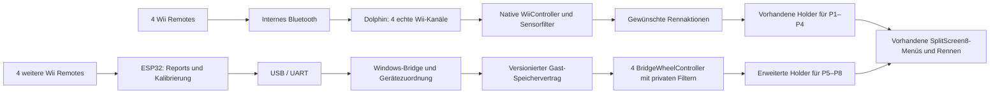

# Umsetzungsplan: Acht echte Wii Remotes in MKWii 8P unter Dolphin

Stand: 24.10.2026 · Zielbranch: `esp32-support` · Status: Planung, keine Implementierung · ergänzt um getrennten Entwicklungsrechner und Ziel-Laptop

**Fortschreibung 25.10.2026:** Das ist der ursprüngliche Plan; den inzwischen implementierten und geprüften Stand führt [IMPLEMENTIERUNGSSTAND.md](IMPLEMENTIERUNGSSTAND.md). Nach erfolgreichem manuellem Stunttest hat der Nutzer die Gerätezuordnung geändert: Wiimotes sollen automatisch freie P5–P8-Plätze erhalten und ohne manuelle MAC-Konfiguration austauschbar sein. Dieser Wunsch ersetzt frühere Vorgaben zu verpflichtenden festen MAC-Reservierungen. Aktive Spieler behalten ihren Platz; bekannte Geräte bevorzugen beim Wiederverbinden ihren bisherigen freien Platz. Die technische Identitätsprüfung bleibt zur korrekten Eingabe-/ACK-Zuordnung erhalten. Aktuelle Bedienung: [START-8-WIIMOTES.md](START-8-WIIMOTES.md).

## 1. Auftrag, Ziel und Arbeitsgrundlage

Dieser Plan konkretisiert das bereitgestellte `PROJEKTBRIEFING-DOLPHIN-8-WIIMOTES.md` für das aktuell ausgecheckte Repository. Der aktuelle Nutzerauftrag ist die Erstellung eines Plans. Die im Briefing beschriebenen Build-, Installations-, Firmware- und Testschritte sind deshalb hier geplante Arbeitspakete; sie wurden durch die Erstellung dieses Dokuments nicht ausgeführt.

Das Ergebnis soll auf dem Windows-Laptop acht echte, unabhängig bedienbare Wii Remotes im Querformat ermöglichen. Die vorhandene SplitScreen8-Implementierung stellt Menüs, Spieler, Kameras und Darstellung bereit. Neu hinzukommen die zusätzlichen Eingabequellen und ihre vollständige Einbindung in den vorhandenen Lebenszyklus.

**Aktualisierte Arbeitsannahme des Nutzers:** Der Entwicklungsrechner besitzt kein Bluetooth-Modul. Der spätere Ziel-Laptop wird ein eingebautes Bluetooth-Modul besitzen. Für Spieler 1–4 wird angenommen, dass die normale Real-Wiimote-Unterstützung von Dolphin auf dem Laptop funktioniert. Diese Annahme ist die Grundlage der Entwicklung und muss nicht vor Beginn der ESP32-Integration auf dem Entwicklungsrechner nachgewiesen werden.

Die Prioritäten sind:

1. Das vom Nutzer akzeptierte Wheel-Fahrgefühl und die gewünschte Tastenbelegung erhalten.
2. Acht unabhängige Geräte einschließlich Anmeldung, Menüs, Rennen und Wiederverbinden zuverlässig betreiben.
3. Alle acht Spieler mit vollständigen menschlichen Eingabe-, Item- und Animationszuständen behandeln.
4. Möglichst stabile 60 tatsächlich gerenderte FPS bei Echtzeit-Spielgeschwindigkeit erreichen und messen.
5. Aufbau und Start so dokumentieren, dass sie sich auf einem frischen Checkout reproduzieren lassen.

Die erste Implementierung wird für **Dolphin, Vanilla und PAL/RMCP01** geplant. Das ist eine bewusste Begrenzung des ersten Nachweises, weil die vorhandene Wheel-Referenz PAL-spezifisch ist. Die aktuelle Mehrregionenstruktur bleibt bei neuen Symbolen und Hooks berücksichtigt. USA/Japan und Retro Rewind erhalten eigene spätere Freigaben; ihre Unterstützung durch das Grundprojekt beweist noch keine Unterstützung des neuen Eingabepfads.

WiiCompiled, echte Wii-Hardware und der alte selbst entwickelte Renderer gehören nicht zum Zielumfang. Der alte Renderer und seine D3–D7R1-Patches werden nicht in die neue Basis übernommen.

## 2. Bestandsaufnahme: bestätigte Befunde und offene Punkte

### 2.1 Revisionsstand

| Bestandteil | Bei der Planung festgestellter Stand | Bedeutung |
| --- | --- | --- |
| Hauptrepository | `Till-glitch/mkwii-8p-splitscreen` | Arbeitskopie des Nutzers |
| Branch | `esp32-support` | Verfolgt `origin/esp32-support` |
| Hauptcommit | `8c9a5e47766a33af0e58a7f82ce4497e3148a8f8` | Titel: `v1.1.0 candidate: USA and Japanese discs, WiiCompiled v0.9.0` |
| Vorgesehener Pulsar-Gitlink | `a9594663478325ca68ab8e8c3cf7fd332524e821` | Neuer als die im Briefing genannte Revision `48cc1a…` |
| Vorgesehener WiiCompiled-Gitlink | `1e9dd43966076eb7a64c959489520ac7a00ba464` | Für den Dolphin-Einstieg kein eigener WiiCompiled-Build erforderlich |
| Vorgesehener wuj5-Gitlink | `3876815b4a002cd848106f757fc1494aa4456a6f` | Vom vorhandenen Asset-Generator verwendet |
| Lokale Submodule | Verzeichnisse leer, noch nicht initialisiert | Ausgewählte Pulsar-Dateien wurden direkt an der gepinnten Revision gelesen |
| Arbeitsverzeichnis | `C:\Users\Till\Documents\mkwii-8p-splitscreen-esp32-support` | 58 Zeichen; liegt innerhalb der README-Empfehlung von ungefähr 60 Zeichen |

Der Plan beruht auf diesem eingefrorenen Stand. Bei Implementierungsbeginn werden die tatsächlich verwendeten Revisionen erneut erfasst. Ein zwischenzeitliches Upstream-Update wird als eigene Änderung behandelt.

### 2.2 Bereits vorhandene Integrationspunkte

Die folgenden Befunde wurden in den Quellen des vorgesehenen Pulsar-Commits geprüft:

| Bereich | Befund | Konsequenz für die Umsetzung |
| --- | --- | --- |
| `SplitScreen8.hpp` | `kMaxLocal = 8`, `kGameLocal = 4`; getrennte Menü- und Rennspielerzahlen | Diese Grenzen und Zustände weiterverwenden |
| `Input.cpp` | Zusätzliche `RealControllerHolder` werden hinter dem nativen Input-Manager angelegt | Über `Holder()` und `PlayerHolder()` zugreifen |
| `InputManager.hpp` | Native Holder, Wii-Controller und GC-Controller sind weiterhin jeweils vier breit | Ein fünfter Wii-/WPAD-Kanal entsteht dadurch nicht |
| `Input.cpp` | Update, Prepare, Eingabesperren, Ghost-Lebenszyklus und Driftzuordnung berücksichtigen zusätzliche Holder | Die neue Quelle muss in diese Reihenfolge passen |
| `Join.cpp` | Zusätzliche Plätze haben `ExtPad`, Anmeldung, Bindung und Wiederverbindungsintegration | Die neue Quelle dort als echte auswählbare Quelle ergänzen |
| `Join.cpp` | Zusätzliche Plätze können beim Wiederverbinden einen freien Controller annehmen | Für feste Geräteidentität gezielt verfeinern |
| `Controller.hpp` | Virtuelle `Input::Controller`-Schnittstelle mit Update, Typ, Kanal, Reset und Driftinitialisierung | Ausgangspunkt für einen eigenen Bridge-Controller |
| `InputState.hpp` | Rennzustand und UI-Zustand sind getrennt; Rennzustand ist `0x18` Byte groß | Rennsteuerung allein deckt die Menüs nicht ab |
| `Locals.cpp` | Zusätzliche menschliche Spieler werden bereits gesondert behandelt | Vorhandene Human- und Darstellungsintegration erhalten |
| Testwerkzeuge | Acht Spieler werden u. a. mit vier GC-Ports und vier Wii-Kanälen mit Classic Controller geskriptet | Bestehende Achtspieler-Tests beweisen keine acht echten Wheels |

Der vorhandene Mehrspielerpfad wird somit um eine Eingabequelle erweitert. Die nativen Vierer-Arrays werden nicht pauschal vergrößert oder mit Indizes 4–7 angesprochen.

### 2.3 Relevante Befunde aus der alten Referenz

Die alten Dateien wurden als Referenz gelesen. Daraus folgen konkrete Aufgaben:

- `wii_sensor_protocol.h` beschreibt W2 mit 32 Byte, vier Slots, kalibrierten Sensorachsen und einer Sequenz pro Slot. Das Paket besitzt eine XOR-Prüfung, keine moderne CRC.
- Die Firmware erfasst native `0x31`-Reports und EEPROM-Kalibrierung. Die Umrechnung der Achsen lautet dort `X = -rawX`, `Y = -rawZ`, `Z = +rawY`; die Bedeutung wird am neuen Eingabepunkt überprüft.
- Die alte Sendeschleife läuft mit ungefähr 60 Hz. Ihr Sequenzzähler steigt beim Versand, auch wenn der zugrunde liegende Sensorreport unverändert ist. Transportfortschritt und frische Sensordaten müssen deshalb getrennt erkennbar werden.
- Die alte Firmware weist Geräte über den ersten freien Platz zu. Eine garantierte Wiederzuordnung zur gleichen Wiimote ist damit noch nicht gegeben.
- Die Wheel-Referenz verwendet private KPAD-/Wheel-Filterzustände und originale PAL-Funktionen. Diese Aufrufe enthalten feste Adressen, die in der neuen Lösung über geprüfte Symbole eingebunden werden müssen.
- Die gewünschten alten Wheel-Hilfsfunktionen sind im gelesenen neuen `symbols.txt` nicht bereits unter ihren alten Adressen eingetragen. Symbol- und ABI-Arbeit ist ein eigenes Paket.
- Die Item-Referenz besitzt eigene Latches und unterschiedliche native Decoder für manuelle und automatische Drift.
- Die alte Bridge schreibt an feste Gastadressen und hängt sich allgemein an Dolphin. Für die neue Lösung werden Prozessidentität, Buildidentität und ein neu definierter Speichervertrag benötigt.
- Die bisherige PlatformIO-Konfiguration referenziert einen veränderlichen Framework-Branch und `COM3`. Für reproduzierbare Builds werden Revisionen gepinnt und Ports erkannt bzw. explizit ausgewählt.
- Die alten PPC-Tests enthalten wertvolle Referenzabläufe. Teilweise ersetzen sie Spezialbefehle oder führen Ressourcenladen und Renderer ausdrücklich nicht aus. Ihre Aussagekraft wird getrennt von echten Dolphin- und Hardwaretests ausgewiesen.

### 2.4 Noch nicht bestätigt

Bestätigte Angaben des Nutzers sind das fehlende Bluetooth-Modul des Entwicklungsrechners und das geplante eingebaute Bluetooth-Modul des Ziel-Laptops. Der ESP32 besitzt seinen eigenen Funkpfad; seine Verbindung zum Entwicklungsrechner erfolgt über USB und benötigt dort kein Bluetooth-Modul.

Offen sind Laptop-CPU/GPU, konkreter Bluetooth-Chip und Treiber, die dort eingesetzte Dolphin-Version, tatsächlicher ESP32-Chip, aktuell angeschlossene Geräte und die erreichbare Funkqualität. Die Systemabfrage über CIM war in der aktuellen eingeschränkten Umgebung nicht verfügbar. Daraus wird keine weitere Hardwareeigenschaft abgeleitet. Der native Viererpfad gilt bis zum späteren Laptop-Test als angenommene Voraussetzung und blockiert die lokale Entwicklung nicht.

Es wurden für diesen Plan weder das Spiel gestartet noch Firmware geflasht, Controller gekoppelt, Eingabelatenzen gemessen oder FPS-Ergebnisse ermittelt. Auch die unveränderte Basis wurde in dieser Arbeitskopie noch nicht gebaut.

### 2.5 Aufteilung zwischen Entwicklungsrechner und Ziel-Laptop

| Umgebung | Eingaben | Dort vorgesehene Arbeiten |
| --- | --- | --- |
| Entwicklungsrechner ohne Bluetooth | Vier emulierte bzw. geskriptete Eingabequellen für P1–P4; bis zu vier echte Wiimotes über den per USB angeschlossenen ESP32 für P5–P8 | Build, Firmware, Protokoll, Bridge, zusätzliche Holder, Wheel-/Item-Referenzprüfungen, Menüs und ESP32-Ausfalltests |
| Ziel-Laptop mit eingebautem Bluetooth | Vier echte Wiimotes direkt über Dolphin; vier echte Wiimotes über ESP32/USB | Native Kopplung, gemeinsame Belegung, echte Achtgeräte-Abnahme, Koexistenz, Fahrgefühlvergleich und abschließende Leistungswerte |

Emulierte oder geskriptete Quellen dienen auf dem Entwicklungsrechner der reproduzierbaren Bedienung und Prüfung des Spiels. Die Bridge-Wheels bleiben dabei an ihren tatsächlichen Spielerplätzen P5–P8. Es ist keine vollständige Belegung aller vier Ersatzquellen für jeden Entwicklungstest erforderlich; die notwendige Spielerzahl wird passend zum Test hergestellt.

Echte native Wheel-Eingaben, deren Funkabbrüche und der direkte Vergleich zum nativen Fahrgefühl werden erst am Laptop geprüft. Lokale Performancewerte dienen der Entwicklung; Aussagen über die erreichbaren FPS auf dem Zielgerät stammen aus Laptop-Messungen.

## 3. Architekturentscheidung und Alternativen

### 3.1 Empfohlener Arbeitsweg

**Der 4+4-Aufbau ist die festgelegte Arbeitsarchitektur. Die Entwicklung beginnt auf dem Rechner ohne Bluetooth; die native Vierergruppe kommt beim späteren Laptop-Test hinzu:**

- Vier Wiimotes erreichen Dolphin über das interne Bluetooth-Modul und dessen normale Real-Wiimote-Unterstützung.
- Vier weitere Wiimotes erreichen den vorhandenen ESP32 und werden per USB/seriell an eine Windows-Bridge übertragen.
- Die Windows-Bridge stellt validierte Eingabesnapshots im Gast bereit.
- Vier zusätzliche Bridge-Wheel-Controller liefern Renn- und UI-Zustände an die bestehenden erweiterten Holder.

Diese Empfehlung verwendet die vorhandene Referenz mit vier zusätzlichen ESP32-Geräten. Sie ist noch kein Nachweis, dass die konkrete vorhandene Hardware diesen Aufbau im neuen Projekt zuverlässig betreibt.

Eine vorgelagerte Untersuchung von acht Wiimotes über ein einziges internes Bluetooth-Modul entfällt. Ebenso ist für die Entwicklung kein zusätzlicher Bluetooth-Adapter am Entwicklungsrechner eingeplant. Sollte der angenommene native Viererpfad am Laptop später ein konkretes Problem zeigen, wird genau dieses Problem behandelt.



P1–P4 bzw. P5–P8 sind hier die geplante Standardzuordnung. Geräteidentität und tatsächlicher nativer Kanal werden in einer separaten Tabelle geführt; das Anmelden eines Geräts wird nicht allein aus dessen Verbindungsreihenfolge abgeleitet.

### 3.2 Warum acht Wiimotes über einen Adapter eine Prüfaufgabe sind

Drei voneinander unabhängige Grenzen müssen unterschieden werden:

1. **Funk:** Bluetooth BR/EDR erlaubt in einem Piconet bis zu sieben aktive Peripheriegeräte. Acht Wiimotes lassen sich daher nicht einfach als acht aktive Peripherals unter demselben Central einplanen. Sondertopologien erfordern einen eigenen Nachweis. [Bluetooth Core, Baseband Specification](https://www.bluetooth.com/wp-content/uploads/Files/Specification/HTML/Core-62/out/en/br-edr-controller/baseband-specification.html)
2. **Emulator:** Der geprüfte Dolphin-Quellstand definiert vier normale Wii-Remote-Kanäle; der zusätzliche Balance-Board-Eintrag ist kein freier fünfter Wheel-Kanal. Die installierte Version muss gesondert erfasst werden. [Dolphin `Wiimote.h`, geprüfte Revision](https://github.com/dolphin-emu/dolphin/blob/e1d35f666cc35f6ead55d32ea2679df44d04da72/Source/Core/Core/HW/Wiimote.h)
3. **Spiel:** MKWii besitzt weiterhin vier native Wii-Controllerobjekte. Acht Spieler-Holder lösen diese Grenze nicht automatisch auf.

Ein zweiter Bluetooth-Adapter erweitert weder Dolphins Kanalzahl noch die Spielarrays von selbst. Er wäre eine weitere Funkquelle für eine geeignete Bridge. Passthrough ist ebenfalls kein automatischer Weg zu acht logischen Wii-Kanälen.

### 3.3 Entscheidungsmatrix

| Option | Nutzen | Wesentliche Voraussetzung | Priorität |
| --- | --- | --- | --- |
| Internes Laptop-Bluetooth für vier native Wiimotes + ESP32 für vier weitere | Entspricht der Nutzerannahme und nutzt vorhandenen Referenzcode | Native Vierergruppe zunächst angenommen; gemeinsamer Betrieb später am Laptop geprüft | Festgelegter Plan |
| Acht Geräte über einen gemeinsamen Windows-Hostpfad | Könnte das Gerätemanagement vereinheitlichen | Belegte Funk-/Treiberfähigkeit und eigener Spiel-Eingabepfad; keine exklusive Konkurrenz zu Dolphin | Zurückgestellt; kein vorgesehenes Arbeitspaket |
| Zusätzlicher USB-Bluetooth-Adapter mit Host-Bridge | Alternative bei ungeeignetem internen Pfad | Windows-Zugriff und eindeutiger Gerätebesitz nachgewiesen | Nur nach konkretem Befund |
| Zweiter geeigneter ESP32 bzw. zweites Bridge-Gerät | Aufteilung weiterer Geräte möglich | Separate Entscheidung über Hardware und gemeinsame Slotverwaltung | Reserveoption |
| Dolphin-Fork mit acht WPAD-Kanälen | Tiefer Eingriff möglich | Änderungen in Emulator, Wii-I/O und Spiel samt Wartung | Eigene Forschungserweiterung; kein Einstieg |
| Nur virtuelle GC-Sticks | Einfacher Nachweis von Bewegung | Erfüllt Sensor-, Wheel- und Menüanforderungen nicht vollständig | Allenfalls Diagnosehilfe |

**Architekturbeschluss A:** Umsetzung mit 4+4. Das Architekturprotokoll hält den getrennten Entwicklungs- und Laptopbetrieb sowie die angenommene native Vierergruppe fest. Deren Hardwareprüfung wird beim Laptop-Transfer nachgeholt und ist keine Voraussetzung für die lokale Bridge-Entwicklung. Alternativen werden erst bei einem tatsächlich beobachteten Problem relevant.

Wiimotes benötigen Bluetooth Classic. Ein beliebiger ESP32-S3/C3 ersetzt den bisherigen ESP32 deshalb nicht. Der tatsächliche Chip wird vor der Firmwarearbeit geprüft. [Bluepad32-FAQ](https://bluepad32.readthedocs.io/en/latest/FAQ/)

## 4. Softwarebausteine und Verantwortlichkeiten

Die Namen neuer Dateien sind Vorschläge und existieren derzeit noch nicht.

| Baustein | Vorgeschlagener Ort | Aufgabe |
| --- | --- | --- |
| Firmware | Hauptrepo: `firmware/esp32-wii-bridge/` | Vier Funkgeräte, EEPROM, Rohreports, Identität, Frische, Paketversand |
| Transportdefinition | Hauptrepo: `shared/` und definierter Build-Import für Pulsar | Byteformat, Versionen, CRC, Zustands- und Fähigkeitsflags |
| Windows-Bridge | Hauptrepo: `tools/wiimote_bridge/` | COM-Gerät, Parser, Mapping, Dolphin-Anbindung, Diagnose, Aufzeichnung |
| Launcher | Hauptrepo: `tools/start_8p_wheels.py` | Vorprüfung, isoliertes Profil, Startreihenfolge, Bridge-Lebenszyklus |
| Gasttransport | Pulsar: `SplitScreen8/WheelBridgeProtocol.hpp`, `WheelBridge.cpp` | Mailbox, Snapshotprüfung, Sitzung, Timeout, begrenzte Diagnose |
| Controlleradapter | Pulsar: `SplitScreen8/BridgeWheelController.hpp/.cpp` | Eigene Controllerobjekte, Typ-/Metadaten, Renn- und UI-Zustände |
| Wheel-Verarbeitung | Pulsar: `SplitScreen8/WheelNative.hpp/.cpp` | Private Filterzustände, Symbolaufrufe, Quantisierung, Spiegelung |
| Aktionsbelegung | Pulsar: `SplitScreen8/WheelActions.hpp/.cpp` | Gewünschte Rennbelegung und Item-Zustandsfolgen |
| Join-/Holder-Anbindung | Bestehende `Input.cpp`, `Join.cpp`, ggf. `Entry.cpp` | Erzeugen, Aktualisieren, Anmelden, Bindungen, Wiederverbinden |
| Messung und Prüffälle | Hauptrepo: `tools/wiimote_tests/` | Protokoll-, Trace-, Integrations- und Messwerkzeuge |
| Anleitungen | Hauptrepo: `docs/` | Architekturentscheidung, Betrieb, Tests, Messergebnisse |

Für den Protokollvertrag gibt es eine maßgebliche Definition. C++- und Python-Repräsentationen werden daraus erzeugt oder mit gemeinsamen Bytevektoren abgeglichen. Ein Buildschritt übernimmt die benötigte Headerdefinition aus dem Hauptrepo kontrolliert in den Pulsar-Build. Ein isoliert verwendetes Pulsar-Submodul benötigt dafür einen ausdrücklich dokumentierten Import; ein stillschweigend vorhandenes Nachbarverzeichnis wird nicht vorausgesetzt.

Die Firmware wird nachvollziehbar aus der alten Referenz übernommen, einschließlich Herkunft und Lizenzprüfung. Das alte Projekt bleibt eine lesbare Referenz. Bibliotheksrevisionen, Compiler und benötigte Python-Pakete werden für die neue Umgebung festgehalten.

## 5. Datenfluss, Protokoll und Speichervertrag

### 5.1 Zwei getrennte Verträge

Der USB-Transport und die Gast-Mailbox erfüllen unterschiedliche Aufgaben und erhalten getrennte Formate:

- **Firmware → Host:** Kleine, eindeutig gerahmte Pakete mit Fehlererkennung und schneller Resynchronisierung.
- **Host → Gast:** Konsistente Snapshots mit Build-/Sitzungsbindung und definiertem Veröffentlichungsverfahren.

W2 bleibt zunächst für Referenzaufzeichnungen lesbar. Das Releaseformat wird als Nachfolger mit eigener Kennung und Version definiert, beispielsweise `W3`. Der Name ist noch keine fertige Spezifikation. Unterschiedliche Formate dürfen nicht anhand zufällig passender Nutzdaten ineinander übergehen.

### 5.2 Geplante Transportfelder

| Feldgruppe | Inhalt und Zweck |
| --- | --- |
| Rahmen | Magic, Protokollversion, Nachrichtentyp, Länge |
| Quelle | Bridge-/Boot-Sitzung und lokale Gerätekennung |
| Gerät/Slot | Transport-Slot, stabile Identitätsreferenz, Verbindungs- und Kalibrierstatus |
| Fortschritt | Paketfolge und davon unabhängige Sensorreport-Folge |
| Zeitbezug | Monotoner Gerätezeitstempel oder Alter des letzten echten Sensorreports |
| Eingaben | Rohe Buttons, kalibrierte Achsen, relevante Bewegungs-/Ereignisinformation |
| Ereignisse | Sequenzierte Button-/Stunt-Ereignisse oder begrenzte Ereigniswarteschlange |
| Integrität | Definierte CRC, z. B. CRC-16/CCITT-FALSE; Parameter und Abdeckung ausdrücklich spezifizieren |

CRC ist eine Prüfung gegen Übertragungsfehler, keine Authentifizierung. Byteordnung, Feldbreiten, Vorzeichen, Überläufe und Verhalten bei unbekannten Flags sind Bestandteil der Spezifikation.

Die Gerätemetadaten können beim Verbinden gesendet werden; die vollständige Bluetooth-Adresse muss nicht in jedem Sensorpaket stehen. Reale Geräteadressen und persönliche Zuordnungen bleiben in lokaler Konfiguration.

### 5.3 Bandbreiten- und Latenzbudget

Bei UART mit 115200 Baud und 8N1 stehen rechnerisch ungefähr 11.520 Nutzbytes pro Sekunde zur Verfügung. Die bisherige Übertragung mit 32 Byte bei 60 Hz benötigt ungefähr 1.920 Byte/s und 2,8 ms reine Übertragungszeit pro Paket. Das sind Rechenwerte, keine Messung der gesamten USB- und Funklatenz.

Vor der Erweiterung werden Paketgröße und maximaler Ereignisverkehr budgetiert. Ein gemeinsames Paket für vier Geräte vermeidet unnötig vervielfachten Headeraufwand. Die Baudrate wird erst erhöht, wenn Messdaten einen Nutzen zeigen und der vorhandene USB-UART-Pfad die gewählte Rate zuverlässig unterstützt.

Der jüngste Sensorzustand ersetzt ältere Zwischenzustände. Kurze Tastendrücke und Stunt-Ereignisse benötigen dagegen eine festgelegte Zustellregel: Sie werden bis zur Übernahme sequenziert vorgehalten und genau einmal verarbeitet. Host und Gast bestätigen den letzten übernommenen Ereignisstand in ihren jeweiligen Rückkanälen; Wiederholungen werden anhand von Sitzung und Ereignisfolge erkannt. Ein bloßes ODER aller seit dem letzten Tick gesehenen Tasten genügt für Press-Release-Press-Folgen nicht. Reihenfolge, Überlauf und maximale Wartezeit der Ereigniswarteschlange werden geprüft. Eine Überlastung führt zu einer sichtbaren Diagnose und Neutralisierung statt zu verspäteten Itemwürfen.

### 5.4 Sichere Anbindung an Dolphin

Der Host bindet sich an den vom Projektstarter erzeugten Dolphin-Prozess mit bekanntem PID und Prozessstartzeit. Vor dem ersten Schreibzugriff werden geprüft:

1. Ausgewählte Installation und Dolphin-Prozess passen zusammen.
2. Spiel-ID und unterstützte Region passen zur gestarteten Variante.
3. Die Bridge-Signatur liegt an einem für diesen Build ermittelten Ort vor.
4. Protokollversion, Speichergröße, Fähigkeitsflags und Buildkennung stimmen überein.
5. Sitzung und Gast-Lebenszyklus sind gültig; Snapshot und Statusbereiche liegen vollständig innerhalb des zulässigen Speicherbereichs.

Die alte Adresse `0x800014E0` wird nicht übernommen. Die bevorzugte Lösung ist eine vom neuen Modul besessene Struktur, deren Adresse über Build-/Linkinformationen und eine geprüfte Laufzeitsignatur ermittelt wird. Falls die Struktur dynamisch liegt, braucht es einen eigens geprüften Discovery-Anker. Ein Speicherbereich wird erst nach Untersuchung von Loader, Allokationen, Hooks und Szenewechseln reserviert. Wiederholte Signaturen oder unklare Bereiche führen zu keinem Schreibzugriff.

Für die vorhandene Python-Speicherbibliothek wird geprüft, ob PID-Auswahl, unterstützte Dolphin-Builds, Speicheransichten und Schreibsemantik ausreichen. Falls nicht, erhält der Prozesszugriff einen klar begrenzten Backendadapter. Der GDB-Stub bleibt ein Diagnosewerkzeug, sofern seine Laufzeiteigenschaften nicht als geeigneter Datenpfad nachgewiesen wurden.

### 5.5 Konsistente Veröffentlichung

Der Host veröffentlicht einen Snapshot über einen definierten Commit-Zähler oder eine entsprechende geprüfte Doppelbuffer-Lösung. Beispiel für einen Commit-Zähler:

1. Generation als „in Bearbeitung“ markieren.
2. Nutzdaten und Integritätsdaten schreiben.
3. Generation als vollständig veröffentlichen.
4. Der Gast liest die Generation, kopiert den Snapshot und liest sie erneut.
5. Nur identische vollständige Generationen mit gültiger Integritätsprüfung werden angenommen.

Gaststatus und Hosteingaben haben getrennte Schreibbesitzer. Paket-CRC und Snapshotkonsistenz werden separat geprüft. Bei Änderungen während des Lesens gibt es höchstens eine feste Anzahl Versuche; der Spielthread wartet nicht unbegrenzt.

Ausrichtung, Schreibreihenfolge, Sichtbarkeit der Gastdaten und Verhalten des konkreten Dolphin-Speicherbackends werden praktisch verifiziert. `volatile` oder eine normale Host-Speicherkopie werden nicht als alleiniger Beweis für einen atomaren Gast-Snapshot behandelt.

### 5.6 Zeit und Timeout

Es werden vier Zeiten bzw. Fortschrittsquellen unterschieden:

- Eingang eines echten Sensorreports am ESP32.
- Eingang eines gültigen Pakets im Windows-Prozess.
- Erfolgreiche Veröffentlichung eines Hostsnapshots.
- Übernahme und Verarbeitung in einem identifizierten Gast-Eingabetick.

ESP32-Zeit, Windows-Monotonzeit und Gastticks werden nicht ohne Synchronisationsmodell voneinander subtrahiert. Der Host prüft seine Empfangsfrische, die Firmware das Sensoralter und der Gast den Fortschritt seiner gültigen Eingangsgenerationen. Für die endgültige Timeoutsemantik wird ein geeigneter Gastzeitbezug unter Echtzeitbetrieb nachgewiesen; nach einer Emulatorpause darf kein veralteter gehaltener Zustand wieder anlaufen.

Vorläufiges Ziel ist eine Neutralisierung spätestens 250 ms nach Verlust frischer Eingaben im Echtzeitbetrieb; der konkrete Wert wird anhand gemessener Paketabstände festgelegt. Bei explizitem Disconnect wird bereits beim nächsten verarbeiteten Tick neutralisiert. Ein veraltetes Sensorpaket bleibt veraltet, auch wenn die USB-Verbindung weiter Heartbeats liefert.

## 6. Integration in Controller und Spielzustände

### 6.1 ABI und Aufrufreihenfolge zuerst belegen

Vor dem ersten Controlleradapter wird eine Tabelle angelegt: Funktion, Symbol, Region, erwarteter Parameteraufbau, verwendete Register, Zustandsspeicher und bekannte globale Abhängigkeiten. Größen und Offsets werden soweit möglich statisch geprüft und durch Debuggerbefunde ergänzt.

Besonders zu prüfen sind:

- Basis- und virtuelle Methoden von `Input::Controller`.
- `Input::State`, `UIState`, `RealControllerHolder` und `ControllerParams`.
- `MotionController`, KPAD-Sensorstatus und private SDK-Filterzustände.
- Zustandsgrößen der alten Wheel- und Item-Helfer gegenüber der neuen Spielbasis.
- Update der Controllerobjekte gegenüber Update der Holder und Menüabfragen.
- `calculateID`, `fillParams`, Typprüfungen und alle Pfade, die aus einem Controllerkanal ein natives Vierer-Array indexieren.

Die Zielreihenfolge ist: Snapshot übernehmen → Controllerzustand einmal berechnen → Holder kopieren aktuellen/vorherigen Zustand → Menüs oder Rennlogik lesen den Holder. Ob die passenden vorhandenen Hooks dies bereits gewährleisten, wird zunächst mit begrenzten Traces belegt.

### 6.2 Eigene Bridge-Wheel-Controller

Vier langlebige Controllerobjekte werden angelegt. Jedes besitzt getrennte Sensor-, Wheel-, Item-, UI- und Verbindungszustände. Die Objekte können von `Input::Controller` abgeleitet werden; ein eigener Adapter isoliert unvollständig bekannte native Implementierungsdetails.

Der Adapter stellt mindestens bereit:

- Renn- und UI-Zustand aus derselben gültigen Quelle.
- Initialisierung und Reset einschließlich Driftmodus.
- Eindeutige Quelle, Verbindungsstatus und geeignete Metadaten.
- Gecachte Ausgabe pro Eingabetick, damit zwei Leser denselben Filter nicht zweimal fortschreiben.
- Vorläufig fehlendes bzw. später asynchrones Rumble ohne blockierenden Pfad.

Ein nativer Kanal 4–7 wird nicht erfunden. Wenn Spielcode bei einem Wii-Controllertyp in die vier nativen Wii-Objekte oder WUD-Metadaten greift, wird dieser Aufruf gezielt über die Bridge-Registrierung aufgelöst. Ein abweichendes Objekt allein durch einen passenden Typwert als `WiiController` erscheinen zu lassen, wäre ohne Prüfung aller Casts und Metadatenzugriffe unsicher.

`ControllerParams::Fill` und `calculateID` erhalten, falls erforderlich, einen klar erkennbaren Bridge-Sonderpfad. Bridge-IDs dürfen nicht mit nativen Wii-/GC-IDs kollidieren. Für nicht betroffene Controller bleibt der bestehende Weg erhalten.

### 6.3 Holder- und Join-Anbindung

- Die vorhandenen Holder 4–7 werden über die bestehenden Zugänge gebunden.
- Bridge-Controller werden vor der relevanten Holder-Aktualisierung aktualisiert.
- `BindPad()` bzw. dessen Bridge-Erweiterung setzt die für den Rennbeginn benötigten Controllerreferenzen und Parameter konsistent.
- Die vorhandene Anmeldung bekommt zusätzliche Bridge-Kandidaten; die native Suche wird nicht durch doppelte Hooks überlagert.
- Beim Verlassen und erneuten Öffnen der Mehrspielermenüs bleiben reservierte Geräteidentitäten erhalten, während die benötigten Holderzustände sauber zurückgesetzt werden.
- Die im Grundprojekt vorhandenen Ghost-, Blockierungs- und Driftpfade werden mit dem neuen Objekt überprüft.

Für 1–4 Spieler und deaktivierte Bridge bleibt die bisher unterstützte Eingabevariante eine eigene Regression. Bei weniger als acht Spielern sind nicht verwendete Bridge-Slots weder anmeldbar noch aktive Menübesitzer.

## 7. Originales Fahrgefühl und einheitliche Aktionen

### 7.1 Lenkung

Die geprüfte Reihenfolge für zusätzliche Geräte lautet:

1. Nativen Sensorreport lesen.
2. EEPROM-Kalibrierung prüfen; primären und gegebenenfalls Ersatzblock auswerten.
3. Achsen und Vorzeichen für den konkret verwendeten KPAD-Koordinatenraum umrechnen.
4. Die bisher verwendete Transportnormalisierung beibehalten oder eine Abweichung gegen die Referenz belegen.
5. Originalen KPAD-Filter mit privaten Zuständen anwenden.
6. Originalen adaptiven Wheel-Zustand fortschreiben.
7. Native Quantisierung mit gleicher Gleitkomma-Operationsreihenfolge verwenden.
8. Spiegelung genau einmal an der richtigen nativen Zustandsgrenze anwenden.
9. Den vollständigen Rennzustand an den Holder übergeben.

Der jüngste gültige Sensorzustand wird pro relevantem Eingabetick verwendet. Ob die native Referenz bei fehlendem neuen Sensorreport den Filter fortschreibt oder eine Ausgabe hält, wird im Vergleich belegt und identisch abgebildet. Ankunftsrate, Simulationstakt und Render-FPS werden nicht gleichgesetzt.

Bei ungültiger Kalibrierung zeigt die Diagnose den Zustand ausdrücklich an. Eine Ersatzkalibrierung kann für Entwicklung vorgesehen werden, zählt aber ohne Vergleich nicht als Freigabe für originales Fahrgefühl.

### 7.2 Gewünschte Rennbelegung

| Physische Eingabe | Gewünschte Wirkung | Zusätzlich zu prüfen |
| --- | --- | --- |
| `2` | Gas | Hold, Release, Wiederverbinden |
| `1` bei Gas | Hüpfen / manuell driften gemäß akzeptierter Referenz | Reihenfolge `1→2` und `2→1`, vorhandene Brems-/Rückwärtssemantik |
| Schütteln | Stunt bzw. kontextabhängige Wheelie-Aktion | Impulsdauer, Bike/Kart, Boost und Animation |
| `B` halten | Geeignetes Item halten | Latch und mehrfach verwendbare Items |
| Richtungsimpuls bei gehaltenem `B` | Item unmittelbar in gewünschte Richtung werfen | Release nicht als Voraussetzung verwenden |
| Steuerkreuz halten / loslassen | Bisher akzeptiertes Halten und Werfen | Physische Richtung bei quer gehaltener Wiimote |
| `A` | Rückblick | Keine versehentliche Item-/Driftauslösung |
| `+` | Pause entsprechend Spielkontext | Alle Plätze und bestehende Pause-Regeln |

Die Rennbelegung wird von Menüaktionen getrennt. Beispielsweise bleibt die erwartete Bestätigung mit `A` in der Anmeldung und Auswahl möglich, obwohl `A` im Rennen den Rückblick auslöst.

**Wichtige Gleichbehandlung:** Die vier direkt von Dolphin gelesenen Wiimotes müssen dieselbe gewünschte Aktionsbelegung erhalten wie die Bridge-Geräte. Die Annahme eines funktionierenden nativen Verbindungswegs sagt noch nichts über die gewünschte eigene B-/1-Belegung aus. Für P1–P4 wird deshalb ein schmaler Aktionsadapter an der geprüften nativen Eingabegrenze vorgesehen, der die native Sensorverarbeitung erhält. Sein Aktionsvertrag kann lokal vorbereitet und mit kontrollierten Eingaben geprüft werden; die vorhandene echte Wheel-Belegung und das Endergebnis werden beim Laptop-Test erfasst.

### 7.3 Items und Stunts

Item-Latches, vorheriger Rohzustand und Richtungsnachlauf sind pro Controller getrennt. Manuelle und automatische Drift verwenden die jeweils passende native Zustandsfolge. D-Pad-Itemrichtungen erzeugen keine zusätzlichen Stuntanforderungen.

Die alte Firmware berechnet einen Schüttelimpuls mit eigener Schwelle und Haltedauer. Diese Vorverarbeitung wird zunächst als Bestandteil der akzeptierten Referenz dokumentiert und mit Rohaufzeichnungen verglichen. Sie gilt nicht allein durch ihren Namen als originaler Stuntdecoder. Falls die native Verarbeitung mehr Sensordaten oder zeitliche Information benötigt, wird das Protokoll entsprechend erweitert.

Bei zusätzlichen Spielern werden Eingabeanforderung, gültiger menschlicher Spielerzustand, Modell-/Animationsanforderung und sichtbares Ergebnis getrennt beobachtet. Erst ein in Dolphin sichtbarer Stunt samt korrektem Boost erfüllt die Anforderung. Alte Renderer- oder LOD-Fixes werden nicht vorsorglich übernommen.

## 8. Geräteidentität, Menüs und Wiederverbinden

### 8.1 Verbindliche Zuordnung

Eine lokale Registrierung verbindet:

`Geräteidentität → Funkquelle → Transport-Slot → logischer Spieler → Menübesitzer → Renn-Holder`

Die Bluetooth-Adresse bzw. eine daraus lokal abgeleitete stabile Kennung identifiziert das Gerät. Die Position in einer zufällig gefüllten Liste tut dies nicht. Für die beiden Funkgruppen gibt es getrennte Erlaubnislisten, damit ein Gerät beim Koppeln nicht vom falschen Empfänger übernommen wird.

Bei nativen Geräten wird die Identität mit der tatsächlich gebundenen Kanal-/WUD-Information abgeglichen. Falls der verwendete Dolphin-Pfad keine automatische stabile Bindung erlaubt, wird eine geführte Anmeldung des reservierten Geräts vorgesehen; ein beliebiges anderes Gerät übernimmt den Platz nicht stillschweigend.

Wiimotes haben vier Spieler-LEDs. Für Spieler 5–8 wird daher ein dokumentiertes lokales Kennzeichnungsschema verwendet, beispielsweise physische Nummern und eine Bridge-Anzeige. Eine einzelne LED wird nicht als eindeutige weltweite Spielernummer ausgegeben.

### 8.2 Geplanter Zustandsautomat je Gerät

`UNBEKANNT → GEKOPPELT → KALIBRIERT → BEREIT → ANGEMELDET → AKTIV`

Aus aktiven Zuständen führen Datenverlust oder Disconnect nach `VERALTET/GETRENNT`. Der Spielerplatz bleibt reserviert. Das bekannte Gerät kann nach frischer Kalibrier-/Sitzungsprüfung und definierter Freigabe zurückkehren. Ein anderes Gerät ersetzt es nur über eine ausdrückliche Neuzuordnung.

Beim Datenverlust werden Gas, Drift, Item, Rückblick, Richtungen und Stuntzustände neutralisiert. Der Reset eines Item-Latchs wird zusammen mit dem nativen Releaseverhalten geprüft, damit keine Taste hängen bleibt und kein alter Richtungswurf nachträglich ausgelöst wird. Ein einmaliger nativer Releaseeffekt wird vom unbeabsichtigten wiederholten Werfen unterschieden.

Während kurzer Ausfälle bleibt der Mensch am reservierten Platz. Es gibt keinen automatischen KI-Ersatz. Für längere Ausfälle wird die vorhandene Wiederverbindungsoberfläche gezielt eingebunden. Der schon vorhandene Dialog wird weder durch falsche Metadaten ständig ausgelöst noch global abgeschaltet, sodass echte Ausfälle unsichtbar würden.

### 8.3 Lebenszyklusfälle

| Ereignis | Erwartetes Verhalten |
| --- | --- |
| Szenewechsel Menü → Rennen | Bindung bleibt gültig; Filter-/Rennzustände passend initialisieren |
| Pause | Kein mehrfacher Filterfortschritt; Diagnose bleibt begrenzt lesbar |
| Resume nach längerer Pause | Nur frische aktuelle Daten; keine alten Trigger wiederholen |
| Driftmoduswechsel | Betroffene private Zustände neu initialisieren |
| Rennneustart / nächstes Rennen | Aktuelle/vorherige Zustände, Blockierung und Bindung konsistent |
| COM-Unterbrechung | Alle betroffenen Eingaben rechtzeitig neutralisieren; Nativeingaben weiter gültig |
| ESP32-Neustart | Neue Bootsitzung; alte Sequenzen und ausstehende Ereignisse verwerfen |
| Hostprozess-Neustart | Neue Sitzung aushandeln, reservierte Zuordnungen wiederherstellen |
| Dolphin-Neustart | PID, Speicheransicht und Discovery komplett neu prüfen |
| Savestate-Laden | Alte Gastgenerationen erkennen; neu synchronisieren und neutral starten |
| Bridge deaktiviert | Vorhandene native Eingaben und bisherige Testpfade weiter nutzbar |

Savestates werden erst dann als unterstützt dokumentiert, wenn ihr Rebind-Verhalten geprüft ist. Bis dahin ist ein kontrollierter Neustart der dokumentierte Entwicklungsweg.

## 9. Arbeitspakete und Entscheidungspunkte

Die Aufwände sind Planungsschätzungen für konzentrierte Entwicklungsarbeit einer Person. Reverse Engineering, Funkprobleme und Hardwareverfügbarkeit können die Spanne vergrößern. Die Reihenfolge kann sich nach dem ersten Nachweis ändern; die Abnahmekriterien bleiben bestehen.

### P0 — Reproduzierbare unveränderte Basis: 2–3 Arbeitstage

- Submodule rekursiv an den dokumentierten Gitlinks initialisieren.
- Toolchain nach aktueller README einrichten: Python 3.12, CodeWarrior Wii 1.7, Kamek und Basispakete.
- Eigene Python-Umgebung anlegen; Bridge-Abhängigkeiten separat ergänzen und ihre kompatiblen Versionen festhalten.
- Vanilla/PAL bauen und mit dem vorhandenen Installer ein getrenntes Dolphin-Profil vorbereiten.
- Ausgangsdateien mit `isolation snapshot` erfassen und nach dem Test mit `isolation verify` vergleichen.
- 1-, 4- und 8-Spieler-Basis auf dem Entwicklungsrechner mit bisher unterstützten emulierten bzw. geskripteten Eingaben dokumentieren; vorhandene Menüläufe und Rauchtests verwenden.
- Aufnahme der echten nativen Wheel-Bedienung und Standardbelegung für den späteren Laptop-Test vormerken.

**Ergebnis:** Buildmanifest, Startweg, Baselineprotokoll, Screenshots und unveränderte Referenzartefakte.

**Freigabe G0:** Die neue Basis funktioniert ohne Bridge. Fehler der unveränderten Basis werden vor der Erweiterung eingeordnet.

### P1 — ESP32-Prüfung und Vorbereitung des Laptop-Transfers: 1–2 Arbeitstage

- Windows- und Dolphin-Version sowie die für lokale Messungen nötigen Daten des Entwicklungsrechners erfassen. Dessen fehlendes Bluetooth als bekannte Eigenschaft dokumentieren.
- ESP32-Chip, USB-UART-Chip, tatsächlichen Port und bisherige Firmwareversion ermitteln.
- Bis zu vier echte Wiimotes über den ESP32 am Entwicklungsrechner lesen; Verbindungsbesitz, Kopplungsablauf und Wiederverbinden protokollieren.
- Lokale Ersatzquellen für P1–P4 einrichten und Bridge-Slots P5–P8 festhalten.
- 4+4-Architektur und native Laptop-Vierergruppe als Arbeitsannahme dokumentieren.
- Laptop-Transfer vorbereiten: Build-/Firmwaremanifest, eigener Dolphin-Benutzerordner und lokal erkannte COM-/Programmpfade. CPU/GPU, Bluetooth-Treiber und Energieprofil des Laptops werden erst dort erfasst.

**Ergebnis:** Funktionsfähiger lokaler ESP32-Gerätepfad, Hardware-/Gerätetabelle und vorbereiteter Laptop-Transfer.

**Freigabe G1-Entwicklung:** Der ESP32-Gerätepfad ist lokal lesbar und den zusätzlichen Plätzen eindeutig zuordenbar. Die native Vierergruppe wird für die weitere Entwicklung angenommen. Der spätere Nachweis `G1-Laptop` umfasst vier echte Geräte direkt über Dolphin und ihren gemeinsamen Betrieb mit der ESP32-Gruppe; er blockiert P2–P6 auf dem Entwicklungsrechner nicht.

### P2 — ABI, Symbole und Tickvertrag: 2–3 Arbeitstage

- Alte Wheel-/Item-Funktionsaufrufe an der neuen PAL-Basis verifizieren.
- Benötigte Symbole ergänzen und bestehende Hookstellen auf Überschneidungen prüfen.
- Konstruktion, Update, Binding, Parametermetadaten und Szenewechsel tracen.
- Geeignete Tickkennung sowie Eingabereihenfolge bestimmen.
- Speichervertrag und Discovery entwerfen und an einer Diagnoseversion belegen.
- Fehlende Headerdefinitionen eng begrenzt und mit Größen-/Offsetnachweisen ergänzen.

**Ergebnis:** ABI-/Symboltabelle, Hookübersicht, Tickdiagramm und Mailboxentwurf.

**Freigabe G2:** ABI und Aufrufreihenfolge sind belegt; ein zulässiger eigener Discovery-Bereich und genau ein geeigneter Updatezeitpunkt stehen fest. Ein diagnostischer Marker lässt sich dem vorhandenen zusätzlichen Holder eindeutig zuordnen. Der produktive Transport und das neue Controllerobjekt folgen in P3/P4.

### P3 — Protokoll, Firmwareanpassung und Hosttransport: 3–5 Arbeitstage

- Format, Ereigniszustellung, Frische, CRC und Sitzungswechsel spezifizieren.
- W2-Referenzleser erhalten; neues Format ausdrücklich aushandeln.
- Firmware um Geräteidentität, Sensorfortschritt und robuste Metadaten ergänzen.
- COM-Erkennung, Auswahl bei mehreren Geräten, Portbesitz und Reconnect umsetzen.
- Hostparser mit begrenztem Puffer und Resynchronisierung implementieren.
- Dolphin-Prozessprüfung, Discovery und konsistente Veröffentlichung umsetzen.
- Aufzeichnen und zeitlich kontrolliertes Wiedergeben eigener Eingabetraces ermöglichen.

**Ergebnis:** Firmware-/Host-Pipeline mit einem bis vier Geräten, reproduzierbaren Paketen und Fehlerdiagnose.

**Freigabe G3:** Gültige Daten erreichen die Diagnose; beschädigte, veraltete und sitzungsfremde Daten verändern keine Spieleingaben.

### P4 — Ein zusätzlicher echter Wheel-Controller: 4–7 Arbeitstage

- Ein Bridge-Controllerobjekt erzeugen und einem zusätzlichen Holder zuweisen.
- Private KPAD-/Wheel-Zustände, native Quantisierung und Item-Latches portieren.
- Renn- und UI-Ausgabe vollständig bereitstellen.
- Zusätzlichen Spieler mit seinem echten Gerät anmelden und ein Rennen fahren.
- Identische Sensortraces gegen akzeptierte Referenz und native Funktion auswerten.
- Stuntanforderung, Boost und sichtbare Animation prüfen.

**Ergebnis:** Erster nutzbarer Nachweis eines echten zusätzlichen Wheel-Controllers auf P5. P1–P4 werden auf dem Entwicklungsrechner bei Bedarf emuliert bzw. geskriptet bedient.

**Freigabe G4:** P5 kann mit seiner echten ESP32-Wiimote selbstständig die erforderlichen Menüs bedienen und mit Wheel-Lenkung, Items und sichtbaren Stunts fahren. Die übrigen lokal verwendeten Eingaben bleiben unabhängig bedienbar. Der fahrpraktische Vergleich mit einer direkt verbundenen echten Wiimote folgt am Laptop.

### P5 — Acht Eingabeplätze, gemeinsame Belegung und vollständige Menüs: 4–6 Arbeitstage

- Auf vier unabhängige Bridge-Controller skalieren.
- Gemeinsame gewünschte Rennaktionen auch für die vier nativen Geräte umsetzen.
- Geräte-/Spielerzuordnung in Join, Auswahl, Pause und Rennen durchgängig verbinden.
- Charakter, Fahrzeug, Drift, Teams, Zurück/Vorwärts und erneute Anmeldung prüfen.
- Mehrere gleichzeitige Eingaben sowie absichtlich gegensätzliche Eingaben testen.
- Anzeige bzw. Diagnose für Quelle, Gerät und Spielerplatz bereitstellen.
- Lokal vier echte ESP32-Wiimotes für P5–P8 und vier kontrollierte Ersatzquellen für P1–P4 verwenden. Dieselben P1–P4-Plätze erhalten beim Laptop-Transfer echte native Wiimotes.

**Ergebnis:** Vollständiger Menü- und Rennweg für acht Eingabeplätze; die zusätzliche Vierergruppe ist lokal mit echten Wheels bedienbar.

**Freigabe G5-Entwicklung:** Alle acht Plätze bestehen die lokal prüfbare Funktionsmatrix, mit getrennten kontrollierten Ersatzquellen für P1–P4 und echten ESP32-Geräten für P5–P8. Gespiegelte Eingaben oder Testautodrive zählen nicht als Nachweis unabhängiger Eingaben. `G5-Laptop` bestätigt dieselbe Matrix später mit acht echten Wiimotes.

### P6 — Lebenszyklus und Ausfallverhalten: 2–4 Arbeitstage

- Einzelgeräte-, Gruppen-, USB-, Host- und Dolphin-Ausfälle gezielt auslösen.
- Feste Reservierung und Rückkehr zur gleichen Spieleridentität absichern.
- Pause, Resume, Rennneustart, Menüwechsel und Bootsessionwechsel prüfen.
- Neutralisierung, Releaseverhalten und Filterreset nachweisen.
- Störende Wiederverbindungsdialoge auf echte Zustandsfehler zurückführen.
- Auf dem Entwicklungsrechner ESP32-, USB-, Host-, Gast- und Szenenfehler prüfen. Echte native Funkabbrüche und das Wiederverbinden der Laptop-Vierergruppe werden zusätzlich beim Laptop-Test geprüft.

**Ergebnis:** Fehlerfallmatrix und dokumentiertes Wiederherstellungsverhalten.

**Freigabe G6-Entwicklung:** Im lokal verfügbaren Gerätepfad kein hängender Input, kein Platztausch, keine fremde Geräteübernahme und kein unbeabsichtigter KI-Ersatz. Die native Funkgruppe erhält dieselben Prüfungen am Laptop als `G6-Laptop`.

### P7 — Laptop-Transfer, Fahrgefühl und End-to-End-Abnahme: 2–4 Arbeitstage

- Reproduzierbaren Quell-/Buildstand und ESP32 auf den Ziel-Laptop übertragen; eigenes Dolphin-Profil einrichten und COM-/Programmpfade dort neu erkennen.
- Vier echte Wiimotes über das eingebaute Bluetooth-Modul mit Dolphin verbinden. Die bisher angenommene Funktion als `G1-Laptop` bestätigen.
- Gemeinsamen 4+4-Betrieb prüfen; `G5-Laptop` und `G6-Laptop` mit echten Geräten abschließen.
- Lenkung, Gegenlenken, schnelle Wechsel, Grenzwerte und Spiegelmodus vergleichen.
- Manuelle und automatische Drift, Kart und Bike sowie alle Item-Zustandsfolgen prüfen.
- Unterschiede zwischen vier nativen und vier gebridgten Wheels messen und mit dem Nutzer fahrpraktisch beurteilen.
- Acht echte Controller mindestens 30 Minuten durch mehrere Rennen betreiben, darunter ein längeres Rennen mit Items, Stunts, Treffern und Respawns.
- Sichtbare Effekte und Animationen auf allen acht Ansichten prüfen.

**Ergebnis:** Abnahmeprotokoll mit Eingabetraces, Videos/Screenshots und bekannten Abweichungen.

**Freigabe G7:** Der Ziel-Laptop besteht den echten 4+4-Betrieb einschließlich `G1-Laptop`, `G5-Laptop` und `G6-Laptop`. Verhalten erfüllt die funktionalen Anforderungen; offene Grenzen sind einzeln beschrieben.

### P8 — 60-FPS-Pfad und Leistungsnachweis: 2–5 Arbeitstage

- Baseline und Bridge-Build auf dem Ziel-Laptop bei 1/4/8 Spielern unter vergleichbaren Bedingungen messen. Frühere Messungen des Entwicklungsrechners nur als Entwicklungsdaten führen.
- Render-, Simulations- und Eingabetakt sowie eventuelle 30-Hz-/Frame-Skip-Pfade bestimmen.
- Vorhandene geeignete Einstellungen bzw. vorhandenen 60-FPS-Pfad der gewählten Variante bevorzugt prüfen.
- Falls ein Patch notwendig ist: konkrete Ursache und betroffene Zeitdomänen belegen, Änderung isolieren und Physik-/Zeitparität prüfen.
- Auflösung und Backend zur Engpassbestimmung kontrolliert variieren.
- Bridgekosten und gelegentliche Latenzspitzen getrennt von Renderingkosten ausweisen.

**Ergebnis:** Vergleichbare Messreihen und eine begründete Entscheidung über 60 FPS.

**Freigabe G8:** 60 gerenderte FPS bei korrekter Echtzeitgeschwindigkeit sind gemessen, oder der noch offene Engpass ist belegt. Eine funktionierende Eingabeintegration und ein nicht erreichtes 60-FPS-Ziel werden getrennt bewertet.

### P9 — Startpaket und reproduzierbare Übergabe: 1–2 Arbeitstage

- Launcher mit Vorprüfung und klaren Fehlermeldungen fertigstellen.
- Firmware-, Host- und Gastversionen gemeinsam dokumentieren.
- Start-/Stoppreihenfolge, Kopplung, Slotzuordnung und Fehlerbehebung beschreiben.
- Frischen Checkout anhand der Anleitung durchgehen.
- Herkunft, GPL-Anforderungen und Credits für übernommene Teile sichern.
- Unterstützte Kombination und offene Kombinationen ausdrücklich auflisten.

**Ergebnis:** Reproduzierbarer Quellstand, Firmwarebuild, Startanleitung und Prüfbericht.

**Freigabe G9:** Die dokumentierte Konfiguration lässt sich ohne Wissen aus der Entwicklungssitzung starten.

### Aufwandsrahmen und kritischer Pfad

Die Pakete ergeben ungefähr **23–41 Entwicklungstage**, mit 25 % Reserve ungefähr **29–52 Tage**. Bei einer voll verfügbaren Person entspricht das grob 6–11 Arbeitswochen. Das ist eine frühe Schätzung, keine Terminzusage; nach G2 und G4 wird neu geschätzt. Eine grundlegende Änderung des Funkpfads oder ein Dolphin-Fork liegt außerhalb dieses Rahmens.

Die Trennung der Rechner verschiebt die echten nativen Tests in P7 und begründet kein zusätzliches Wartepaket vor der Implementierung. Der Ziel-Laptop wird spätestens für P7/P8 benötigt. Seine Verfügbarkeit beeinflusst den Kalendertermin der endgültigen Abnahme, nicht den Beginn der lokalen Entwicklung.

Der kritische Pfad ist:

`Entwicklungsrechner: G0 Basis → G1-Entwicklung ESP32 → G2 ABI/Tickvertrag → G3 Transport → G4 zusätzliches Wheel → G5-Entwicklung acht Plätze → G6-Entwicklung Stabilität`

`Ziel-Laptop: Transfer + G1-Laptop native Vierergruppe → G5-Laptop/G6-Laptop echte 4+4-Prüfung → G7 Fahrgefühl/Dauerlauf → G8 Zielgerät-Messung → G9 Übergabe`

Messinstrumente und Baselineerfassung beginnen früh. Aufwendige Renderänderungen beginnen erst nach einer funktionierenden, vergleichbaren Eingabebasis.

## 10. Prüfstrategie und messbare Abnahme

Die folgenden Prüfungen sind geplant. Es werden drei Nachweisstufen getrennt: reine Daten-/Funktionsprüfung, laufender Dolphin mit kontrollierten Eingaben und End-to-End-Betrieb mit echten Geräten.

Jedes Prüfprotokoll nennt zusätzlich den Rechner und die Art der Quellen. „Acht Eingabeplätze lokal geprüft“ und „acht echte Wiimotes am Ziel-Laptop geprüft“ sind unterschiedliche Nachweise. Das fehlende Bluetooth-Modul am Entwicklungsrechner ist kein Fehlerfall und kein Grund, ESP32-Prüfungen auszusetzen.

### 10.1 Protokoll- und Funktionsprüfungen

| Kennung | Prüffall | Abnahmekriterium |
| --- | --- | --- |
| T01 | Paket in beliebigen USB-Fragmenten, mehrere Pakete pro Read, Störbytes | Nur vollständige gültige Pakete übernehmen; begrenzter Puffer |
| T02 | Bitfehler, falsche Länge/Version/Slot, doppelte/veraltete Folge | Verwerfen und diagnostizieren; keine Eingabeveränderung |
| T03 | Sequenz- und Zeitüberlauf, ESP32-/Hostneustart | Sitzung korrekt erkennen; keine alten Ereignisse |
| T04 | Wiederholter Transport ohne neue Sensorreports | Sensoralter läuft weiter; Timeout bleibt wirksam |
| T05 | Kurzimpulse und Press-Release-Press zwischen Gastticks | Definierte Reihenfolge, keine Doppelereignisse oder verspäteten Würfe |
| T06 | Schreibabbruch und Snapshot während Veröffentlichung | Kein halb geschriebener Gastzustand |
| T07 | EEPROM gültig/ungültig/Ersatzblock, Sensorgrenzen | Kalibrierstatus und Vorzeichen nachvollziehbar |
| T08 | Referenztraces für Lenkung | Quantisierte Werte und Zustandsübergänge entsprechen der geprüften Referenz |
| T09 | Itemfolgen manuell/automatisch | Halten, Richtungsimpuls, Release und Nachlauf entsprechen den unabhängigen Referenzabläufen |

Die alten `verify-wheel-*`-Prüffälle werden in eine eigenständige neue Umgebung überführt. Alte Speicheradressen, Hookstellen, Ressourcen und Assertions werden einzeln geprüft. Erwartungswerte werden nicht aus derselben Implementierung berechnet, die der Test prüfen soll.

### 10.2 Funktionsmatrix für alle acht Plätze

Für jeden Spielerplatz werden mindestens folgende Abläufe geprüft:

- Anmeldung und eigene Bestätigung, Ablehnen und erneute Anmeldung.
- Eigenständige Charakter-, Fahrzeug- und Driftauswahl sowie Rücknahme.
- Teamzuordnung und geltende Menübesitzregeln.
- Gas, Hüpfen/Drift, Gegenlenken, Rückblick und schnelles Wechseln.
- `B` halten, jede physische Itemrichtung, Werfen beim Richtungsimpuls und Release.
- Kartstunt, Bikestunt, Wheelie-Kontext, Boost und sichtbare Animation.
- Pause entsprechend den Spielregeln, Fortsetzen, Rennneustart und nächstes Rennen.
- Disconnect beim Gasgeben, Driften und Itemhalten; Wiederverbinden mit gleichbleibendem Spielerplatz.

Unabhängigkeit wird mit identifizierbaren Mustern geprüft: ein Spieler lenkt dauerhaft links, ein anderer rechts, weitere wechseln Gas/Drift/Items zu verschiedenen Zeiten. Neben den Holdertraces werden die jeweiligen Karts und Menücursors beobachtet.

Die vorhandenen Skripte wie `v-8p-vs-race.txt`, `v-8p-back-every.txt` und die 1–4P-Referenzen werden als Regression weiterverwendet. Ein ergänzender Bridge-Testmodus muss die gleiche Controllerintegration verwenden wie echte Eingaben. `--wiimotes` in den bisherigen unattended-Werkzeugen erzeugt Classic-Controller-Testeingaben und ist keine Hardwareabnahme. `--boot-autodrive` dient gegebenenfalls dem Renderer-/Rennfortschrittstest und zählt nicht als menschliche Eingabeprüfung.

### 10.3 Fehler- und Dauerprüfungen

- Jedes einzelne Gerät mindestens zehnmal trennen und am gleichen Platz wieder verbinden.
- ESP32-USB mindestens fünfmal trennen; Nativeingaben müssen nachvollziehbar weiter funktionieren.
- Bridge während gehaltener Tasten beenden und neu starten.
- Dolphin beenden und mit neuem PID starten; keine Schreibzugriffe auf einen alten Prozess.
- Nach Ruhephase, Windows-Fokuswechsel, längerer Pause und Rennneustart fortsetzen.
- Funkstrecke bei realistischem Spielabstand und normaler gleichzeitiger WLAN-/Bluetooth-Nutzung prüfen.
- Mindestens 30 Minuten Dauerbetrieb mit allen acht echten Geräten; zusätzlich reproduzierbare Fehlerfälle mit gezielter Paketverzögerung.

Ein positiver Dauerlauf ersetzt keine gezielten Ausfallprüfungen. Zufällige Funkabbrüche werden mit Sensoralter, Paketfolgen und Host-/Gastfortschritt eingegrenzt.

### 10.4 Leistungs- und Zeitmessung

| Größe | Messweg | Vorläufiges Abnahmekriterium |
| --- | --- | --- |
| Gerenderte FPS | Ausgegebene Frames und Frametimeverteilung | Für den 60-FPS-Meilenstein dauerhaft nahe dem gemessenen Ziel von 60 |
| Dolphin-Speed/VPS | Emulatoranzeige bzw. geeignete Telemetrie | Echtzeitbetrieb nahe 100 %; VPS/FPS nicht gleichsetzen |
| Frametime | p50/p95/p99, Anzahl großer Spitzen | Vorschlag: p95 ≤ 20 ms, p99 ≤ 33,3 ms in warmen Messläufen |
| Rennuhr gegen reale Zeit | Wiederholte 30-s-Fenster ohne Lade-/Pausephase | Vorschlag: Abweichung höchstens 1 %, Messunsicherheit dokumentieren |
| Sensor-/Transportalter | Geräte- und Hostzähler | Keine unbemerkten alten Eingaben; Timeout eingehalten |
| Host → Gast | Veröffentlichungs-/Übernahmetelemetrie mit Zeitzuordnung | Verteilung und Ausreißer dokumentieren; kein konstantes zusätzliches Wartetick |
| Bewegung/Tastendruck → sichtbare Wirkung | Geeignete Videoaufnahme, z. B. 120/240 fps | Vorschlag: zusätzliche p95-Latenz der Bridge höchstens ein 60-Hz-Tick gegenüber nativem Pfad |
| Bridgekosten | Vergleich identischer Läufe mit aktiver/inaktiver Diagnose und Bridge | Keine systematische relevante Verlangsamung; Ausreißerursachen erklären |

Die numerischen Schwellen sind **vorgeschlagene Projektkriterien**, noch keine zugesicherten oder gemessenen Eigenschaften. Insbesondere beim Latenzvergleich werden unterschiedliche Geräte und Videoquantisierung als Messunsicherheit berücksichtigt.

Die Messmatrix enthält 1, 4 und 8 Spieler, mindestens eine einfache und eine anspruchsvollere Strecke sowie Items und Stunts. Nach Shader-Aufwärmung werden je Konfiguration drei ungefähr zweiminütige Läufe erfasst. Kaltstarts und Shaderkompilierung werden zusätzlich separat ausgewiesen. Build, Dolphin-Version, Backend, Auflösung, Energieprofil, Bildausgabe und Controllerpfad bleiben in jeder Reihe dokumentiert.

Hardwareläufe prüfen die gesamte Kette. Replays dienen dem kontrollierten Code-/Performancevergleich und ersetzen keine Funk- oder Fahrgefühlabnahme.

## 11. Vorgehen bei Leistungsproblemen

1. **Emulation zu langsam:** CPU-Zeiten, Speed/VPS und ursprünglichen SplitScreen8-Build vergleichen.
2. **GPU begrenzt:** Interne Auflösung kontrolliert reduzieren und Renderbackend vergleichen; Spieler- und Streckenzustand konstant halten.
3. **Eingaben verspätet bei stabilem Bild:** Sensoralter, UART-Puffer, Hostwarteschlangen und Snapshotübernahme messen.
4. **Unregelmäßige Spitzen:** Shaderkompilierung, Logs, Screenshots, USB-Rückstau, Funkabbrüche und Hintergrundlast getrennt prüfen.
5. **Tatsächlich nur 30 gerenderte FPS:** Render-/Skip-Entscheidung und zugrunde liegenden Tickpfad untersuchen. Eine Anzeige oder ein pauschaler Timerpatch reicht als Befund nicht aus.

Ein notwendiger 60-FPS-Patch darf nicht Rennuhr, Physik, Animation, Audio oder Filter doppelt fortschreiben. Jede Änderung bekommt einen Vergleich gegen reale Zeit und gegen denselben Eingabetrace. Niedrige LODs, reduzierte Sichtweite oder unterdrückte Effekte werden nicht aus dem alten Projekt übernommen.

Debugging wird über Buildoptionen und gezielte Aufzeichnung eingeschaltet. Der Normalbetrieb verwendet begrenzte Zähler und zusammengefasste Diagnosen; keine dauernden Per-Frame-Logs oder synchronen Screenshot-/Dateioperationen im Eingabepfad.

## 12. Hauptrisiken und Gegenmaßnahmen

| Risiko | Früher Nachweis | Maßnahme / Ausweichweg |
| --- | --- | --- |
| Native Laptop-Vierergruppe funktioniert entgegen der Arbeitsannahme nicht | G1-Laptop in P7 | Konkretes Dolphin-/Treiber-/Kopplungsproblem behandeln; lokale ESP32-Entwicklung bleibt davon unabhängig |
| Ziel-Laptop für die Schlussprüfung noch nicht verfügbar | Terminierung von P7/P8 | Lokale Entwicklung und ESP32-Prüfungen fortsetzen; echte Gesamtfreigabe und Zielgerätmessung bis zum Laptop-Test offen führen |
| ESP32 ohne BR/EDR | Chipidentifikation | Geeigneten vorhandenen Chip verwenden oder Hardwarebedarf feststellen |
| Dolphin und Bridge beanspruchen dasselbe Gerät | Getrennter und gemeinsamer Kopplungstest | Feste Empfängergruppen und Gerätebesitz |
| Falscher Typ/Kanal löst native Arrayzugriffe aus | G2, gezielter Metadatentrace | Bridge-IDs und geprüfte Spezialpfade; keine fingierten WPAD-Kanäle |
| Alte PAL-Adressen oder Objektlayouts stimmen nicht | Symbol-/ABI-Tabelle | Neue Symbole, Layoutprüfungen und unabhängige Referenzläufe |
| Halbe RAM-Schreibvorgänge | Snapshot-Fehlerinjektion | Konsistenzgeneration, CRC, begrenzte Leseversuche |
| Frische USB-Pakete enthalten alte Sensorwerte | T04 | Sensorfolge/-alter getrennt vom Transportfortschritt |
| Doppelte Filterupdates oder verlorene Kurzimpulse | Ticktrace und T05 | Ausgabe pro Tick cachen; Ereignisse separat sequenzieren |
| P1–P4 und P5–P8 bedienen sich unterschiedlich | Gemeinsame Aktionsmatrix | Nativen Aktionsadapter und Bridge-Adapter gegen denselben Vertrag prüfen |
| Wiederverbinden vertauscht Spieler | G6 | Identitätsreservierung, Sitzungswechsel, ausdrücklich gesteuerte Ersatzzuordnung |
| Boost vorhanden, Animation fehlt | G4/G7 mit Bildnachweis | Menschlichen Spieler-/Modellzustand untersuchen; nur konkreten Defekt beheben |
| 60 FPS überschreiten Laptopbudget | Baseline und G8 | Engpass belegen, passende Einstellungen prüfen; Zielstatus offen ausweisen |
| Schmutziges Submodul lässt sich nicht reproduzieren | Frischer Checkout | Pulsar-Änderungen in erreichbarem Fork committen und Gitlink nachziehen |
| Ungepinntes Framework verändert Firmwarebuild | Frischer Firmwarebuild | Versionen/Commits und Paketquellen einfrieren |

## 13. Git-, Build- und Veröffentlichungsstrategie

Die Implementierung wird in kleinen logisch prüfbaren Änderungen aufgebaut:

1. Grundlagenmanifest und Baseline-Dokumentation.
2. Protokollvertrag und Referenzpakete.
3. Firmware-/Hosttransport mit Diagnose.
4. Pulsar-Symbole, Discovery und ein zusätzlicher Controller.
5. Native Wheel-/Item-Parität und gewünschte Belegung.
6. Acht Geräte, Menüs, feste Identität und Ausfallbehandlung.
7. Messung, gegebenenfalls isolierter 60-FPS-Eingriff und Startanleitung.

Änderungen unter `external/rr-pulsar` sind Änderungen an einem eigenen Gitrepository. Vor der finalen Übergabe werden sie in einem erreichbaren, berechtigten Fork mit nachvollziehbarer Historie gespeichert; anschließend zeigt das Hauptrepo auf den entsprechenden Commit und gegebenenfalls die richtige Submodule-URL. Ein Hauptrepo-Commit mit nur lokal verändertem Submodul ist kein reproduzierbarer Lieferstand.

Der genaue Forkname wird erst festgelegt, wenn die vorhandenen Schreibrechte und Repositories geprüft sind. Für die Planerstellung werden keine Repositories angelegt, Commits veröffentlicht oder Pull Requests erstellt.

Eine abschaltbare Bridge-Buildoption ermöglicht den Vergleich mit dem bisherigen Eingabepfad. Performanceänderungen werden unabhängig von der Controllerintegration gehalten, sodass deren Auswirkungen getrennt messbar bleiben.

Spielabbilder, extrahierte Nintendo-Dateien, erzeugte Spielressourcen und persönliche Profile gehören nicht in Git. Öffentlich verteilte Bestandteile behalten die erforderlichen Lizenztexte, Quellenverweise und Credits, insbesondere für therenow9 und die verwendeten Bibliotheken.

### Geplante erste Einrichtung

Die folgenden Befehle beschreiben die spätere Ausführung in der Repositorywurzel. Werkzeugpfade, lokale Spielauswahl und das isolierte Profil müssen zuvor entsprechend der aktuellen README feststehen.

```powershell
git submodule update --init --recursive
py -3.12 -m venv tools/.venv
tools/.venv/Scripts/python.exe -m pip install capstone json5
tools/.venv/Scripts/python.exe tools/build_code.py --vanilla
tools/.venv/Scripts/python.exe tools/install_8p.py --vanilla isolation snapshot
tools/.venv/Scripts/python.exe tools/install_8p.py --vanilla prepare
tools/.venv/Scripts/python.exe tools/install_8p.py --vanilla code vanilla
tools/.venv/Scripts/python.exe tools/install_8p.py --vanilla dolphin
tools/.venv/Scripts/python.exe tools/install_8p.py --vanilla isolation verify
```

Die README-Toolchain, insbesondere CodeWarrior und Kamek sowie `.env`, wird vor dem Build separat eingerichtet. Für Buildskripte, die intern `git` starten, muss ein funktionsfähiges Git im PATH stehen. In dieser Umgebung trat mit MSYS-Prozessen innerhalb der Sandbox eine Zugriffsbeschränkung auf; das ist ein Einrichtungsbefund, kein Fehler des Projekts.

## 14. Optionale Erweiterungen nach der Kernabnahme

**Rumble:** Asynchronen Rückkanal nach erfolgreicher Eingabeintegration ergänzen. Feedback enthält Zielgerät, Sitzung und eigene Sequenz; veraltete Befehle werden verworfen. Eingaben haben Vorrang vor Feedback.

**Feedback-Toggle:** Die im Briefing gewünschte Kombination `+` und `−` wird als bewusste gemeinsame Umschaltung vorgesehen. Beide Einzelaktionen, insbesondere Pause, müssen beim erkannten Akkord passend unterdrückt werden. Ob der Toggle lokal pro Gerät oder für die Gruppe gilt, wird vor dieser optionalen Implementierung festgelegt; das Briefing legt nur die gemeinsame Umschaltung von Rumble und Lautsprecher fest.

**Lautsprecher:** Erst angehen, wenn echte brauchbare Audiodaten, Timing und nicht blockierender Versand belegt sind. Die bisher schlecht bewerteten Ersatzsounds werden nicht als Originalton übernommen.

**Retro Rewind:** Nach erfolgreicher Vanilla-Abnahme in einem eigenen Profil bauen und Modi, Menüvarianten sowie belastende Strecken gesondert prüfen.

**USA/Japan:** Alle neuen Symbole regional auflösen, `region_check.py` verwenden und auf echten zugehörigen Spielversionen testen. PAL-Ergebnisse werden nicht als Mehrregionennachweis ausgegeben.

**Andere Funkarchitektur:** Nur bei nachgewiesenem Nutzen auf Basis desselben Gastcontroller- und Protokollvertrags ergänzen.

## 15. Fertigstellungskriterien und Lieferumfang

Die funktionale Implementierung gilt als fertig, wenn:

- [ ] Der Quellstand mit allen Submodulen reproduzierbar gebaut werden kann.
- [ ] Acht echte Wiimotes gleichzeitig unabhängig erreichbar und eindeutig Spielern zugeordnet sind.
- [ ] Alle acht Plätze dieselbe gewünschte Rennbelegung und die nötige Menübedienung besitzen.
- [ ] Lenkung, Drift, Items und Stunts gegen Referenz und praktische Fahrprüfung abgenommen sind.
- [ ] Stunts, Spieler und Itemeffekte für alle acht Spieler sichtbar korrekt dargestellt werden.
- [ ] Ausfälle neutralisieren; Wiederverbinden vertauscht keine Spieler und aktiviert keine KI.
- [ ] 1–4-Spieler-Regression und vorhandene 8P-Skriptpfade geprüft sind.
- [ ] Ein längerer Lauf mit acht echten Controllern dokumentiert ist.
- [ ] 1/4/8-Spieler-Messungen zu FPS, Speed/VPS, Frametime, Latenz und Rennuhr vorliegen.
- [ ] Startanleitung, Slotbelegung, Hardwareentscheidung und bekannte Grenzen dokumentiert sind.

**Der 60-FPS-Meilenstein erhält zusätzlich eine eigene Freigabe.** Er ist erst erfüllt, wenn tatsächlich gerenderte Frames und Echtzeitgeschwindigkeit gemeinsam nachgewiesen sind. Falls die konkrete Hardware das Ziel noch nicht erreicht, bleibt dieser Meilenstein ausdrücklich offen, auch wenn die acht Eingaben bereits vollständig funktionieren.

Vorgesehene Übergabedokumente:

- `docs/ARCHITEKTUR-WIIMOTE-BRIDGE.md`: begründete Architektur und Besitz der Funkgeräte.
- `docs/WIIMOTE-PROTOKOLL.md`: Transport, Gastvertrag, Bytebeispiele und Versionsregeln.
- `docs/START-8-WIIMOTES.md`: Einrichtung, Firmware, Kopplung, Zuordnung, Start und Fehlerbehebung.
- `docs/TESTBERICHT-8-WIIMOTES.md`: geprüfte Kombinationen, Rohmessungen und Freigaben.
- `docs/BUILD-MANIFEST.md`: Repository-/Submodule-/Toolchain-/Firmware-/Dolphin-Versionen.
- Lokale gitignorierte Konfiguration und Messartefakte; keine persönlichen Pfade oder Geräteadressen als universelle Vorgaben.

## 16. Quellen und Nachweisgrenzen

### Projektquellen

- Nutzerbriefing: `C:\Users\Till\Documents\8 Player MK\PROJEKTBRIEFING-DOLPHIN-8-WIIMOTES.md`.
- Ergänzende Nutzerangabe: Entwicklungsrechner ohne Bluetooth; Ziel-Laptop mit eingebautem Bluetooth; P1–P4 über Dolphin werden als funktionierende Voraussetzung angenommen. Diese spätere Angabe konkretisiert die Reihenfolge und ersetzt die vorgelagerte Bluetooth-Machbarkeitsprüfung im ursprünglichen Briefing.
- [README des aktuellen Hauptcommits](https://github.com/Till-glitch/mkwii-8p-splitscreen/blob/8c9a5e47766a33af0e58a7f82ce4497e3148a8f8/README.md): Build, Plattformen, Layout, Lizenz und Werkzeuge.
- [SplitScreen8 `Input.cpp`](https://github.com/therenow9/rr-pulsar/blob/a9594663478325ca68ab8e8c3cf7fd332524e821/PulsarEngine/SplitScreen8/Input.cpp): zusätzliche Holder und Lebenszyklus.
- [SplitScreen8 `Join.cpp`](https://github.com/therenow9/rr-pulsar/blob/a9594663478325ca68ab8e8c3cf7fd332524e821/PulsarEngine/SplitScreen8/Join.cpp): Anmeldung, Bindung und Wiederverbinden.
- [SplitScreen8 `SplitScreen8.hpp`](https://github.com/therenow9/rr-pulsar/blob/a9594663478325ca68ab8e8c3cf7fd332524e821/PulsarEngine/SplitScreen8/SplitScreen8.hpp): gemeinsame Zugänge und Grenzen.
- [GameSource `Controller.hpp`](https://github.com/therenow9/rr-pulsar/blob/a9594663478325ca68ab8e8c3cf7fd332524e821/GameSource/MarioKartWii/Input/Controller.hpp), [InputManager.hpp](https://github.com/therenow9/rr-pulsar/blob/a9594663478325ca68ab8e8c3cf7fd332524e821/GameSource/MarioKartWii/Input/InputManager.hpp), [InputState.hpp](https://github.com/therenow9/rr-pulsar/blob/a9594663478325ca68ab8e8c3cf7fd332524e821/GameSource/MarioKartWii/Input/InputState.hpp), [ControllerHolder.hpp](https://github.com/therenow9/rr-pulsar/blob/a9594663478325ca68ab8e8c3cf7fd332524e821/GameSource/MarioKartWii/Input/ControllerHolder.hpp): derzeitige Schnittstellenbeschreibung; Kommentare allein ersetzen keinen ABI-Nachweis.
- [GameSource `symbols.txt`](https://github.com/therenow9/rr-pulsar/blob/a9594663478325ca68ab8e8c3cf7fd332524e821/GameSource/symbols.txt): bestehende Symbole.
- Lokal gelesene Referenzen: `esp32_to_dolphin.py`, Firmware `main.cpp`, `platformio.ini`, `wii_bridge.h`, `wii_wheel_native.h`, `wii_wheel_items.h`, `wii_sensor_protocol.h` sowie ausgewählte alte Verifier unter der alten Projektwurzel.
- Lokal gelesene Werkzeuge: `tools/build_code.py`, `tools/install_8p.py`, `tools/lane.py`, `tools/smoke_8p.py` und ausgewählte `tools/menu_scripts/`.

### Externe technische Grundlagen

- [Bluetooth Core 6.2, Baseband Specification](https://www.bluetooth.com/wp-content/uploads/Files/Specification/HTML/Core-62/out/en/br-edr-controller/baseband-specification.html): Grenze pro aktivem BR/EDR-Piconet.
- [Dolphin Wii-Remote-Kanaldefinition an Revision `e1d35f6…`](https://github.com/dolphin-emu/dolphin/blob/e1d35f666cc35f6ead55d32ea2679df44d04da72/Source/Core/Core/HW/Wiimote.h): vier normale Wii-Remote-Kanäle im geprüften Quellstand; keine Aussage zur lokal installierten Version.
- [Bluepad32-FAQ](https://bluepad32.readthedocs.io/en/latest/FAQ/): Wiimote-/BR/EDR-Anforderung und Unterschiede der ESP32-Familien.

Die Architektur, Dateiaufteilung, Aufwände, Timeoutziele und Abnahmeschwellen dieses Dokuments sind Planungsvorschläge auf Grundlage dieser Befunde. Nicht durchgeführte Hardware- und Leistungsmessungen bleiben ausdrücklich offen.
